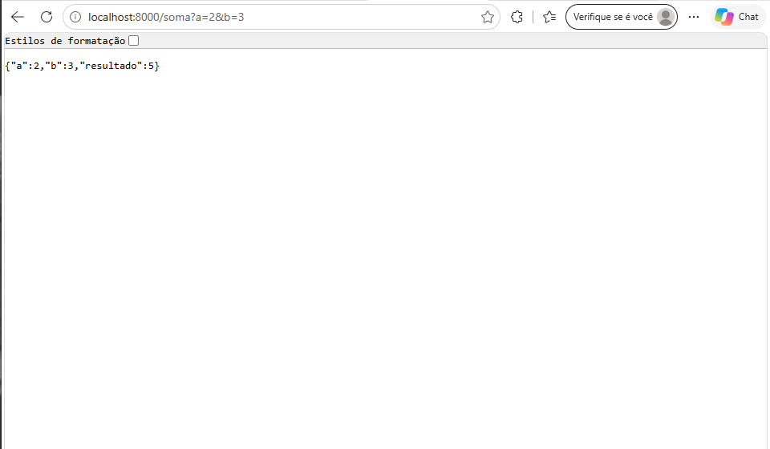
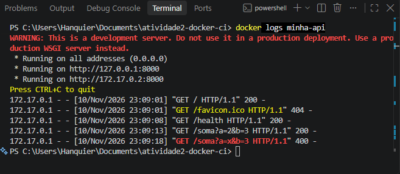

# Atividade 2 — API Flask com Docker e integração contínua

[](https://github.com/arthurhanquier081/atividade2-docker-ci/actions/workflows/ci.yml)

## Descrição da aplicação

API web simples feita em Python com Flask. Ela roda dentro de um contêiner Docker, escuta na porta 8000 e responde em JSON nestes endereços:

| Endereço | O que devolve |
| --- | --- |
| `/` | Mensagem de boas-vindas |
| `/health` | `{"status":"ok"}`, usado para saber se a aplicação está viva |
| `/soma?a=2&b=3` | A soma de `a` e `b`. Se faltar parâmetro ou não for número inteiro, devolve erro 400 |

## Estrutura do projeto

```text
atividade2-docker-ci/
├── .github/workflows/ci.yml   # workflow do GitHub Actions (CI)
├── tests/test_api.py          # testes automatizados (pytest)
├── docs/                      # prints que comprovam o funcionamento
├── app.py                     # a aplicação Flask
├── requirements.txt           # bibliotecas da aplicação
├── requirements-dev.txt       # bibliotecas dos testes (pytest e requests)
├── Dockerfile                 # instruções para construir a imagem
├── .dockerignore              # o que o Docker ignora no build
├── .gitignore                 # o que o Git ignora
└── README.md                  # este arquivo
```

## Como construir a imagem (build)

```bash
docker build -t minha-api:1.0 .
```

## Como executar o contêiner (run)

```bash
docker run -d --name minha-api -p 8000:8000 minha-api:1.0
```

## Como verificar que está funcionando

Abra no navegador:

- http://localhost:8000/
- http://localhost:8000/health
- http://localhost:8000/soma?a=2&b=3

Ou veja os logs do contêiner:

```bash
docker logs minha-api
```

## Como parar e remover o contêiner

```bash
docker stop minha-api
docker rm minha-api
```

## Evidências do funcionamento

Aplicação respondendo no navegador:



Contêiner em execução:



## Testes automatizados

Os testes ficam em `tests/test_api.py`. Eles fazem pedidos HTTP à aplicação em execução (no contêiner) e conferem as respostas.

| Teste | O que verifica |
| --- | --- |
| `test_pagina_inicial_responde_200` | `/` responde 200 e traz a chave `mensagem` |
| `test_health_retorna_status_ok` | `/health` responde 200 com `{"status": "ok"}` |
| `test_soma_retorna_resultado_correto` | `/soma?a=2&b=3` responde 200 com `resultado` igual a 5 |
| `test_soma_com_parametro_invalido_retorna_400` | `/soma` com parâmetro que não é número responde 400 |

Para rodar localmente (com o contêiner em execução e o ambiente virtual ativo):

```bash
pip install -r requirements-dev.txt
pytest -v
```

## Integração contínua (GitHub Actions)

O workflow `.github/workflows/ci.yml` roda a cada **push na branch `main`** e a cada **Pull Request** para a `main`. Em uma máquina Ubuntu do GitHub, ele:

1. baixa o código do repositório;
2. constrói a imagem Docker da aplicação;
3. inicia um contêiner a partir dela;
4. espera a aplicação responder em `/health`;
5. instala o Python e as dependências dos testes;
6. executa os testes automatizados com `pytest`;
7. remove o contêiner (sempre, passando ou falhando).

Se algum teste falhar, o `pytest` termina com código de saída diferente de zero e o workflow inteiro falha.

## Experimento: falha proposital no CI

**O que foi alterado.** Em uma branch chamada `erro-proposital`, a linha da rota `/soma` em `app.py` passou de `a + b` para `a - b`, e foi aberto um Pull Request para a `main`.

**O que o CI mostrou.** O teste `test_soma_retorna_resultado_correto` falhou com `assert -1 == 5` (1 teste falhou e 3 passaram), e o workflow ficou vermelho.

**Causa da falha.** A rota `/soma` passou a subtrair em vez de somar. Com `a=2` e `b=3`, a aplicação devolveu -1, mas o teste esperava 5.

**Como foi corrigido.** O código voltou a usar `a + b`. Os testes não foram alterados. O CI do mesmo Pull Request passou e, em seguida, o PR foi mesclado na `main`.

| Situação | Link |
| --- | --- |
| Primeira execução do CI (passou) | https://github.com/arthurhanquier081/atividade2-docker-ci/actions/runs/42928947675 |
| CI com o erro proposital (**falhou**) | https://github.com/arthurhanquier081/atividade2-docker-ci/actions/runs/42930401898 |
| CI depois da correção (**passou**) | https://github.com/arthurhanquier081/atividade2-docker-ci/actions/runs/42931840616 |
| Pull Request | https://github.com/arthurhanquier081/atividade2-docker-ci/pull/1 |